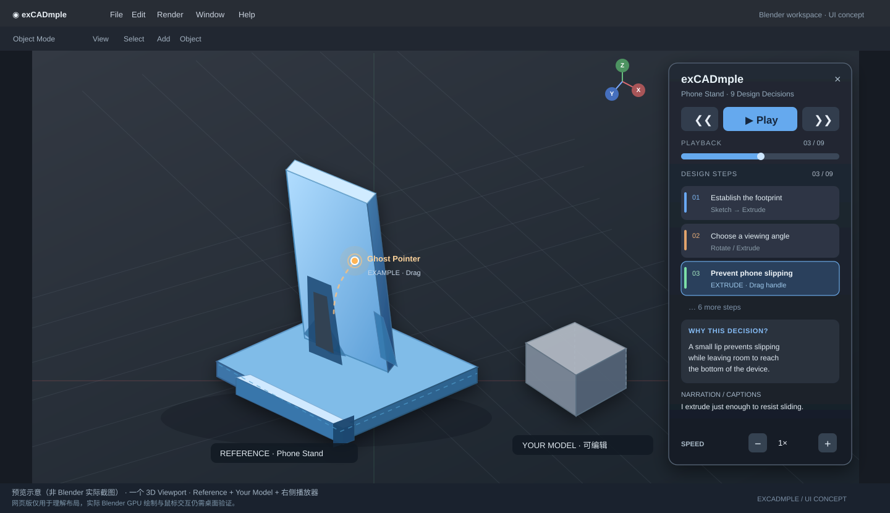

# exCADmple

**Supporting Design Reasoning Through Shared CAD Models**

设计师通过分享 CAD 模型和教程来交流与复用设计。共享的模型提供了最终几何和建模步骤，却很少说明设计师**为什么**做出这些决定；CAD 教程通常带用户一步步复现模型，较少关注决策背后的推理。因此，想在他人设计基础上继续工作的用户，可能明白模型是怎么建出来的，却难以根据**自己的设计目标**判断哪些选择应该保留、哪些应该重新考虑。

**exCADmple** 让用户直接在自己的 CAD 工作空间中探索他人的设计过程与推理。通过交互式时间轴，用户可以播放整个设计过程，也可以重访单个步骤。每一步展示模型如何演变、原设计师如何执行相应的 CAD 操作，并同步播放解释设计选择的语音与文字。用户可以完整跟随案例，也可以在同一工作空间中发展自己的设计时，有选择地借鉴个别步骤——用原设计师的推理辅助自己的决定，而不受示范做法的约束。exCADmple 支持用户学习的不只是**怎么建模**，还有**怎么设计**。

*示意图，非软件实拍。* [交互式浏览器预览](https://html-preview.github.io/?url=https://github.com/Scaffolder666/exCADmpleFusion/blob/blender/docs/preview.html)（第三方 HTML Preview 服务；不含真实建模功能）。

## 用户如何使用

1. 在自己的 CAD 工作空间里做自己的设计。
2. 打开一个教程：它是另一位设计师录下来的设计过程。
3. 播放整个教程，或者一步一步看：每一步可以重播，也可以跳到下一步。每一步有：
   - 模型怎么变化（参考模型放在用户模型旁边，或在第二个窗口里）；
   - 用了哪些工具，以及鼠标轨迹；
   - 设计师当时说的话：原声或电子音朗读，同时显示文字。
4. 随时回到自己的设计，借鉴或不借鉴，由用户自己决定。

## 教程从哪里来

教程就是录下来的东西，不额外添加信息（规范：[EXAMPLE_FORMAT.md](https://github.com/Scaffolder666/exCADmpleFusion/blob/fusion/docs/EXAMPLE_FORMAT.md)）：

| 步骤 | 做法 |
|---|---|
| 1. 录制 | 设计师在 Fusion 里建模，边做边说（think-aloud），同时录屏 |
| 2. 提取 | exCADmple 插件从设计师的 `.f3d` 导出时间轴上每个特征之后的模型 |
| 3. 转写 | 录音转成带时间的文字稿 |
| 4. 切分步骤 | 录制时插件已记下每个特征出现的时间和用到的工具；AI（Claude）据此和文字稿提议怎么切分、每步叫什么，研究者在浏览器里对着录像检查调整（`fusion` 分支的 `tools/author.py`、`ui/author.html`） |
| 5. 合成 | 生成 `.excadmple` 教程包，Fusion 和 Blender 都能播放 |

## 分支

为了决定论文采用哪种界面，Fusion 上做了**两个功能相同、界面组织不同**的版本：

| 分支 | 职责 |
|---|---|
| `main` | 本页：项目介绍与共同研究目标 |
| [`fusion-him`](https://github.com/Scaffolder666/exCADmpleFusion/tree/fusion-him) | **版本 A：独立参考视口**，按 *History in Motion* 的做法：第二个 Fusion 实例打开设计师 `.f3d` 的副本，按 HiM 的方式在真实的参数化模型上展示每一步（时间轴回滚到当前特征，参数从约 0 实时增长到实际值，其他 Body 半透明），用户可以随时旋转查看；右侧是 HiM 式纵向步骤列表；在参考模型上选中几何，用 HiM 算法找出做出它的步骤并播放。用户在第一个 Fusion 窗口中继续建模，两个窗口通过本机连接互通 |
| [`fusion`](https://github.com/Scaffolder666/exCADmpleFusion/tree/fusion) | **版本 B：Fusion 视口内 Overlay**。参考模型与用户模型同在 Fusion 画布中；教程以浮在画布上的紧凑面板和固定在画布角落的 HUD 文字呈现。[说明](https://github.com/Scaffolder666/exCADmpleFusion/blob/fusion/README.md) |
| [`blender`](https://github.com/Scaffolder666/exCADmpleFusion/tree/blender) | Blender 原生 Overlay 原型：单视口 GPU 教程栏、独立的案例播放时钟、多案例切换，读取同一种案例包。[说明](https://github.com/Scaffolder666/exCADmpleFusion/blob/blender/blender/README.md) |
| [`authoring-plan`](https://github.com/Scaffolder666/exCADmpleFusion/tree/authoring-plan) | 制作工具的设计记录（工具本身已实现在 `fusion` 分支） |

两个 Fusion 版本使用相同的案例、相同的推理内容和相同的播放能力，共用同一份代码，只由 `config.json` 中的 `layout` 区分。可以比较：

- 独立视口是否更容易专注理解参考设计；
- 同一视口是否更容易把参考信息与自己的设计联系起来；
- 两种界面如何影响用户在看教程和继续建模之间的切换。

技术上，Fusion 原生画布不允许插件叠加可交互的 HTML，所以版本 B 用浮动面板加画布内的 Custom Graphics（参考模型、Ghost Pointer、HUD 文字）尽量接近 Overlay；Blender 则可以直接在视口中绘制并接收点击。版本 A 需要案例包中带有设计师的 `.f3d`。

## 目标交互与 HiM 验证标准

**设计原则：** exCADmple 向设计师呈现原作者的建模过程、操作与其本人表达的设计理由；系统**不需要理解用户当前的设计目标，也不替用户推理或推荐正确答案**。用户自行判断借鉴哪些步骤，并能随时继续编辑自己的 CAD 模型。

**版本 A（`fusion-him`）的目标流程：**

1. 用户在第一个 Fusion 窗口正常打开自己的设计文件。
2. 点击 **Load Example**，选择包含原设计师参数化 `.f3d` 的 `.excadmple` 案例包。
3. 打开独立的 Fusion 参考窗口，在**原设计师 CAD 模型的副本**上查看和旋转模型；第一个窗口仍用于用户自己的建模。
4. 按原始 Fusion Feature Timeline 顺序播放，或跳转、重播单个步骤。支持的 Feature 使用 **HiM 式真实参数驱动动画**：临时改变参数，由 Fusion 重新计算几何，而不是只播放预渲染视频或几何快照。无适用参数的 Feature 可以使用明确标注的淡入效果；Sketch 可以通过时间轴状态呈现。
5. 每步同步显示使用的工具、与几何的关键交互（例如选中 Profile、拖动 Manipulator 的方向或位置）、原设计师的语音和文字。**不要求记录与建模无关的鼠标运动。**
6. 用户随时回到第一个窗口继续建模，参考窗口不得修改或保存用户的模型。

**版本 B（`fusion`）** 以同一 Fusion Canvas 内的参考几何和教程 Overlay 呈现相同的设计过程信息；两个版本先分别实现，再决定论文采用哪个。两者底层动画机制目前不同，不应声称已经完全等价。

**完成判定（尚待 Fusion Desktop 实测）：** 使用一个真实录制的参数化 `.f3d` 案例，验证导入、步骤与 Feature 精确对应、Extrude/Fillet 等参数动画、跳转/暂停/恢复、语音文字同步、独立窗口连接、用户持续建模以及关闭后原模型不被修改。若 Feature 映射不明确，应报告未匹配，不能猜测或播放其他操作。当前录制器仅捕获工具启动和离散几何选择位置，**还不能还原真实 Manipulator 拖拽路径**；这一能力需单独验证或补充录屏标注。

## 当前状态

- 附带两个**手工编写的示例**（九步 Phone Stand、Tablet Stand），用于演示交互，不是真实录制。
- 真实案例的完整流程（录制 → 提取 → 标注 → 播放）已有格式与工具，尚待第一个真实案例验证。
- 两个插件都通过了自动化测试（Fusion 端为纯 Python 与模拟接口测试；Blender 端在真实 Blender 4.5 中运行），但尚未完成桌面端的人工交互测试。

## 研究启发

建模历史动画与按几何过滤特征的思路来自 *History in Motion*（Veuskens et al., SCF 2023，[DOI](https://doi.org/10.1145/3623263.3623358)）。exCADmple 关注的不是检查一个模型的历史，而是**用户在设计自己的产品时，如何借鉴他人表达的设计推理**。

---

研究原型，持续开发中。
